# Initial Setup
```sh 
sudo adduser koda && sudo adduser dako 
sudo addgroup devteam
sudo usermod -aG devteam koda 
sudo usermod -aG devteam dako 
```
result initialize 

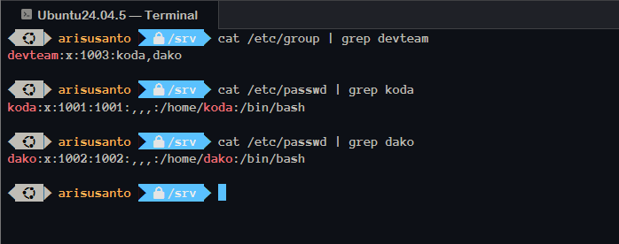

# 2. Make koda owner dand group owner devteam of projectX
```sh
# because i already on srv 
sudo mkdir projectX
sudo chown koda:devteam projectX 
```
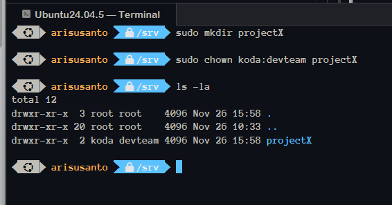

# 3. Restricting Access
```sh
sudo chmod 750  projectX
```
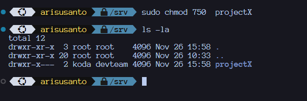

# 4. As user koda create following structure
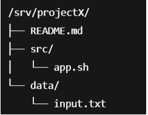
```sh
su koda
cd projectX/
touch README.md
mkdir src && touch src/app.sh
mkdir data && touch data/input.txt
```
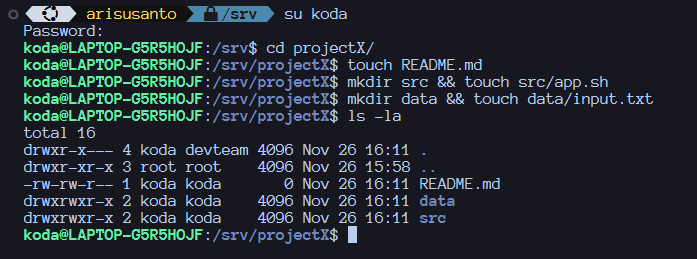

# 5. Fixing permission
```sh
sudo chmod ug+x,o-x app.sh
```
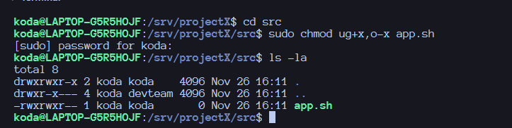

# 6. Protecting sensitive data
```
sudo chmod 600 input.txt 
```
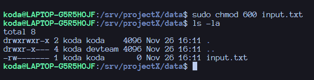

# 7. Allow group collaboration
```sh
# change ownerhsip of src because from step
# 4 - 6 the src was own by groups koda
sudo chown :devteam src
sudo chmod -R 775 src
```
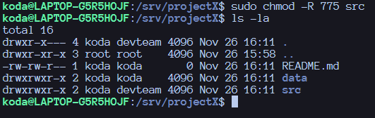

# 8. Change ownership
```sh
sudo chown -R koda:devteam projectX/ 
```
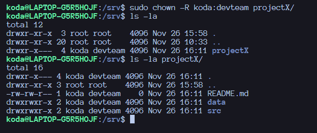

# 9. Prevent Accidental Deletion
```sh
sudo chmod 774 projectX
```
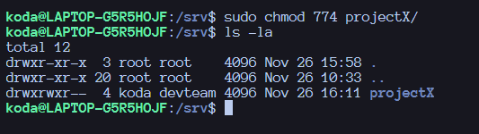

# 10. Make readme readonly
```sh
sudo chmod 744 README.md 
```
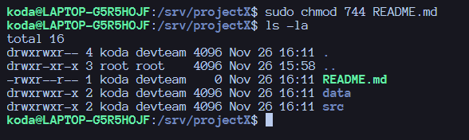

# 11. Resignation and project handover
```sh
sudo chown dako -R projectX/
```
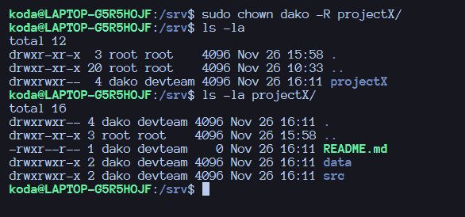

